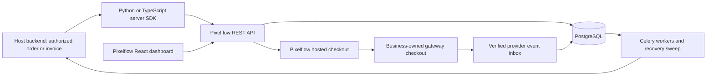
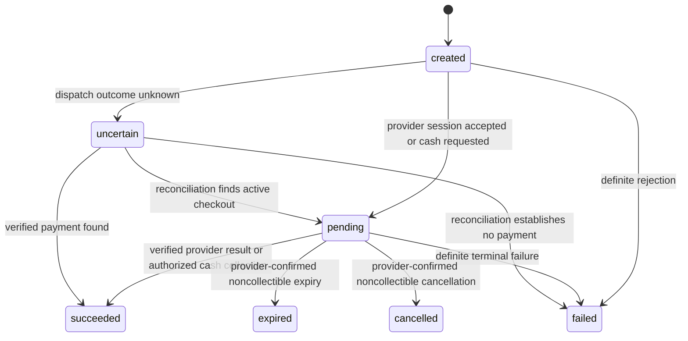

# Pixelflow: shared Philippines-first payments

Date: 2026-10-24 (Asia/Manila).

Status: proposed design for review. No Pixelflow repository, application code,
merchant account, credential, deployment, or host integration has been created.

## Intent and decisions already supplied

Pixelflow is the name chosen by the user for an independently maintained payments
product. PixelCore, Medframe, DineEase, and future projects integrate with the
same service through small installable SDKs and hosted checkout sessions.

The user approved Django, Django REST Framework, PostgreSQL, Celery, Redis,
Docker, Python and TypeScript SDKs, and REST/OpenAPI contracts. The frontend
choice is React, Vite, TypeScript, Tailwind CSS, upstream shadcn/ui, React Router,
TanStack Query, React Hook Form, and Zod. GCash, Maya, cards, and recorded cash
collection are the initial methods. Stripe informs the developer experience.

The last complete brief explicitly requested planning deliverables only. The
subsequent request says “implement that.” An explicit scope question is pending:
planning first, or a new repository plus a working MVP. This specification can be
reviewed independently of that answer; product implementation waits for it.

Success means payment behavior changes are maintained once, compatible server
updates reach connected hosts through one deployment, and each host retains
ownership of its business records and fulfillment rules. Package changes still
require consumers to install a version and deploy where applicable.

## Inspection evidence and limits

Read-only source inspection, not a runtime or security audit:

| Host | Verified source | Integration implications |
| --- | --- | --- |
| PixelCore | `pixelcore-backend/commerce/models.py`: `PaymentConnection`, `PaymentAttempt`, `Refund`, `WebhookEvent`; `commerce/services.py`: `create_paymongo_checkout`, `verify_paymongo_signature`, `process_paymongo_webhook`; `operations/models.py`: `Invoice`, `PaymentAllocation` | Existing PayMongo checkout, order confirmation, booking projection and delivery triggers belong to the host. Adapt new payments without duplicating those triggers or rewriting historical attempts. |
| Medframe | `/home/micxsz/projects/medframe/services/api/medframe_apps/billing/models.py`: `Invoice`, `Payment`, `Refund`, `FinancialEvent`; billing installment projection and history modules | Amounts already use integer minor units. Host authorization, issued invoices, installment obligations, refunds, actor identity and financial projections remain authoritative. No clinical data is needed by Pixelflow. |
| DineEase | GitHub `Bomikuu/dineEase`, default branch `master`: `dineease-web/payments/models.py`, `views.py`, `webhooks.py`; frontend `package.json` and `components.json` | Existing Stripe PaymentIntent, refund and webhook paths require a deliberate provider migration. Existing Stripe payments continue to reconcile/refund through their original provider. The local protected source path was unavailable and untouched. |

PixelCore and Medframe graphify queries located the payment and frontend concepts.
Both payment traversals were truncated; their graphs are source maps, not proof
of complete behavior or fresh coverage. Relevant source was checked directly.
No DineEase graph was available in this session. The remote branch can differ
from a private or unpushed local checkout.

Jev recommended the business-owned merchant-account model with confidence 1.0
(435 input / 42 output tokens). Only generic architecture state was submitted;
no credentials, customer information, clinical records or business data. This
judgment is advisory, not merchant approval or a verified financial contract.

## Architecture

Use one modular Django service, one React administration app, a separate checkout
entry, background workers, PostgreSQL, and Redis. Start without microservices.



Host customers may use an ordinary checkout link; they do not install the
dashboard. No React dependency enters the TypeScript SDK. Vue and React hosts
can use the same API and checkout URL. Optional framework wrappers are deferred
until a real integration needs them.

### Proposed repository structure

```text
pixelflow/
  PRODUCT.md                  confirmed product truth
  DESIGN.md                   selected visual system and token ownership
  UX-CONTRACT.md              shared navigation, forms and recovery behavior
  AGENTS.md                   tooling, boundaries and verification policy
  apps/api/
    config/                   Django settings, routing and Celery setup
    accounts/                 projects, tenants, memberships and scoped keys
    payments/                 payables, sessions, attempts, refunds and cash
    providers/                protocol, registry and PayMongo adapter
    events/                   inbox, immutable events, outbox and deliveries
    audit/                    append-only actor and operation history
    tests/                    domain, API, authorization and provider contracts
  apps/dashboard/             React/Vite administration app
  apps/checkout/              isolated React/Vite public checkout entry
  packages/sdk-typescript/    core/browser-safe and server-only entry points
  packages/sdk-python/        server client and webhook verification
  examples/django-nuxt/       standalone integration example
  examples/django-next/       standalone integration example
  docs/                      design, provider evidence, API and operations
  compose.yaml                API, workers, scheduler, PostgreSQL and Redis
```

The two frontend entries may share a UI package, theme utilities and generated
types. Checkout must not import dashboard navigation, administration pages or
transaction tables. Runtime CSS tokens are the single implementation source
for theme values documented in DESIGN.md.

## Ownership, identity and money flow

Proposed MVP model: each business connects its own approved merchant account.
Pixelflow coordinates requests and records; the provider settles funds under
that business's merchant agreement. Pixelflow does not hold balances, distribute
pooled funds, perform split payouts or implement marketplace onboarding.

This is a proposed business decision for review, not a conclusion that any
provider permits the arrangement without approval.

Boundaries:

- **Project:** integrating application, such as PixelCore or Medframe.
- **Tenant:** a business within a project; external host identity is immutable.
- **Environment:** `test` or `live`; part of every credential and payment scope.
- **Merchant connection:** one provider account within tenant/environment scope.
- **Membership:** a named dashboard actor's access to explicitly granted tenants.
- **API key:** a hashed credential bound to one project/tenant/environment with
  explicit scopes and revocation. Tenant/environment cannot be supplied to
  escape the key's scope.

Initial role capabilities: viewer reads transactions; collector confirms cash;
finance requests refunds and reconciles; owner manages connections, keys and
webhook endpoints. Owners receive finance/collector capabilities explicitly.
Membership checks apply server-side to every object and operation. A selected
tenant in the browser is presentation state, never authorization.

Dashboard authentication uses secure Django sessions and CSRF protection through
a same-origin deployment. Server integrations use scoped bearer API keys. Public
checkout uses a high-entropy, expiring session capability with minimal readable
data and no privileged API operations.

## Payment data and invariants

All initial amounts are PHP integer centavos. Reject booleans, fractional values,
negative/zero payments, unknown currencies and amounts beyond documented bounds.
The host must authorize the payable amount before calling Pixelflow. Pixelflow
cannot independently inspect an arbitrary host database.

The host supplies a validated payable snapshot: external payable ID and version,
amount due for this payment, currency, permitted methods, description safe for
the payer, and allowlisted return URLs. It must not send clinical details or
unnecessary customer records. Validate totals, currency and references again
against gateway results before recording payment success.

| Record | Purpose and required constraints |
| --- | --- |
| Payable snapshot | Tenant/environment/external ID/version and authorized amount. Host installment and allocation policies remain outside Pixelflow. |
| Checkout session | Opaque public token, expiry, allowed methods, validated theme and return URLs. One active collectible checkout per payable generation. |
| Payment attempt | Method, requested amount, gateway references, state, timestamps and reconciliation condition. Scope gateway identifiers to merchant connection. |
| Refund | Attempt, reserved amount, requested actor/reason, provider reference, state and idempotency identity. Pending/uncertain refunds reserve the refundable amount. |
| Cash collection | Collector, confirmed amount, collection time, reference and immutable audit link. Selecting cash creates a pending request, not a collection. |
| Provider event inbox | Merchant/environment, stable provider event identity or verified alternative deduplication identity, body digest, processing outcome and failure reason. |
| Domain event/outbox | Immutable event ID, API/event version, scoped payment reference and minimal snapshot. Created in the same DB transaction as the domain change. |
| Delivery | Endpoint, event, attempt count, next attempt, lease, response summary and terminal/retry state. No credential or response body dumps. |
| Audit entry | Named actor or verified provider identity, scope, action, object, time and safe reason. Financial corrections append events instead of erasing history. |

Use PostgreSQL unique constraints, check constraints and row locks to implement
these invariants. Do not rely on browser disabling, Redis locks or read-before-
write checks alone. Test concurrency against PostgreSQL.

### Idempotency

Every financial POST requires an idempotency key. Persist operation name,
tenant/environment, canonical request fingerprint and resulting object. Same key
and payload returns the original operation; a changed payload returns 409.

Persist the attempt/operation before calling a gateway. Do not hold an open DB
transaction during a network request. A timeout after dispatch is `uncertain`,
not a definite failure. A replay returns that same operation and never creates a
second provider request blindly. Recovery uses the known provider reference or
manual reconciliation. A new idempotency key must not bypass an unresolved
collectible attempt for the same payable generation.

Provider-side idempotency support must be verified from its contract. Sending
an `Idempotency-Key` header is not proof that the provider honors it.

## Lifecycles



Local checkout expiry stops new public actions; it does not prove an existing
gateway URL can no longer collect. Cancellation/expiry is only terminal for the
payment when provider state confirms it. A later verified successful payment
must be recorded and flagged for host reconciliation even if local UX expired.
Late failure events never regress an already verified success.

Refund state is independent: `requested`, `pending`, `succeeded`, `failed`, or
`uncertain`. Payment financial summary exposes gross paid, confirmed refunded,
reserved refund amount and refundable amount. A successful refund does not erase
the original successful payment or conflate it with payout settlement.

Settlement remains `unknown` until supported provider evidence establishes it.
Payment success is not proof that the business's bank account received a payout.

Cash confirmation requires a collector/finance-capable actor, exact payment
amount, collection time and reference. Corrections use an audited reversal or
cash-refund record; they never masquerade as electronic gateway refunds. Reversal
policy is a separate reviewed capability, not a generic status-edit field.

## Provider contract and initial PayMongo integration

Proposed provider interface:

```text
capabilities(connection, method, payment_context) -> CapabilitySet
create_checkout(snapshot, operation_id) -> CheckoutResult
retrieve_checkout(provider_reference) -> ProviderSnapshot
expire_checkout(provider_reference) -> ProviderSnapshot
create_refund(payment_reference, amount, reason, operation_id) -> RefundResult
retrieve_refund(refund_reference) -> RefundSnapshot
verify_event(raw_body, headers, connection, now) -> VerifiedProviderEvent
```

Normalize provider failures into definite rejection, retryable read failure,
uncertain write outcome, unsupported capability and authentication/configuration
failure. Never switch providers automatically after an uncertain write.

PayMongo hosted checkout v2 is the initial recommendation. It supports a hosted
payment flow; the provider handles card entry. Method names map `maya` in the
public API to PayMongo's documented `paymaya` identifier when enabled. Method
availability is the intersection of Pixelflow policy, business configuration and
merchant capabilities. No raw card number, expiry or CVV enters Pixelflow.

The adapter must validate the actual merchant webhook envelope. The current
hosted-checkout guide and general webhook guide show different envelope examples;
do not guess that one parser covers both. Pin verified fixtures and reject
unrecognized envelopes without recording success.

Verify PayMongo signatures over timestamp plus the exact raw body using HMAC
SHA-256, the connection's environment-specific signature and a 300-second replay
tolerance. Separate test/live secrets and identities. Signature verification
precedes trusting event IDs, amounts, merchant identity or payload content.

Persist authenticated incoming events before acknowledgment. Process through a
recoverable inbox worker; malformed, unmatched and inconsistent events remain
visible for reconciliation rather than disappearing as successfully processed.

### Provider research recorded 2026-10-24

| Topic | Evidence and consequence |
| --- | --- |
| Checkout | PayMongo recommends v2 for new hosted integrations. See https://docs.paymongo.com/docs/payment-channels-hosted-checkout |
| GCash/Maya identifiers | PayMongo lists `gcash` and `paymaya`. See https://docs.paymongo.com/docs/payment-acceptance-e-wallets |
| Signatures | PayMongo documents `t`, `te` and `li`, raw-body signing and environment selection. See https://docs.paymongo.com/docs/developer-tools-webhook-setup-management |
| Refunds | Method-specific windows and restrictions apply, including same-day Maya partial refunds. See https://docs.paymongo.com/docs/payment-acceptance-refunds |
| Merchant setup | The quick start documents merchant/KYC and key prerequisites. See https://docs.paymongo.com/docs/payment-channels-hosted-checkout-quick-start |
| Fees | Consult current pricing and the actual merchant agreement. Do not hardcode advertised rates into payment totals. See https://www.paymongo.com/en/pricing |
| Alternative | Maya Checkout provides hosted checkout with capabilities depending on merchant setup; sandbox and production differ. A direct adapter is deferred. See https://developers.maya.ph/reference/about-maya-checkout and https://developers.maya.ph/docs/maya-checkout |

No merchant credentials or account contract were inspected. No gateway request,
sandbox payment, live payment, refund, settlement or formal provider acceptance
test was performed. Exact configured fees, account eligibility, settlement
schedule, provider write-idempotency guarantees and supported webhook envelope
require account-specific confirmation before live enablement.

## Proposed REST contract

All server endpoints use `/api/v1/`. Public IDs are opaque. Pagination, error
envelopes, UTC timestamps, integer amounts and environment are consistent.

| Endpoint | Principal and behavior |
| --- | --- |
| `POST /checkout-sessions` | Scoped server key creates an authorized payable snapshot/session; requires idempotency. Returns session ID, payment ID and Pixelflow checkout URL. |
| `GET /payments` | Scoped server key or authorized dashboard session; server pagination and allowlisted filters. |
| `GET /payments/{id}` | Same scope; payment, refund and reconciliation summary. Cross-tenant IDs return no object. |
| `POST /payments/{id}/refunds` | Finance-scoped principal; amount/reason, capability checks, idempotency and concurrency reservation. |
| `POST /payments/{id}/cash-collections` | Collector-scoped principal; records actual collection. |
| `POST /payments/{id}/reconcile` | Finance scope; requests a provider read/reconciliation job, not an unverified status change. |
| `GET /events` | Scoped durable event history for host catch-up. |
| `GET /deliveries` | Authorized delivery diagnostics with redacted error summaries. |
| `POST /deliveries/{id}/redeliver` | Authorized, audited replay of the same immutable event. |
| `POST /webhooks/paymongo/{connection_id}` | Public transport; authenticated by the connection's provider signature. |
| `GET /public/checkout/{token}` | Expiring capability; minimal payer-safe amount, business, allowed methods and status. |
| `POST /public/checkout/{token}/continue` | Same capability; starts or resumes one allowed provider checkout/cash request. Cannot confirm success. |

Dashboard-only session, tenant selection, connection, endpoint and key-management
routes use the same domain services with explicit permissions. Secrets are
write-only except newly issued keys shown once. Do not put API keys in local
storage, frontend configuration or generated HTML.

Error shape:

```json
{"error":{"code":"IDEMPOTENCY_CONFLICT","message":"This request key was already used with different details.","request_id":"opaque-id","details":{}}}
```

Messages must not expose provider bodies, credentials, internals or other tenants.
Schema names, required fields and response examples become an OpenAPI artifact
before client implementation.

## Events, delivery and recovery

Versioned events initially include `payment.pending`, `payment.succeeded`,
`payment.failed`, `payment.reconciliation_required`, `refund.succeeded`,
`refund.failed`, and `cash.collected`. Define exact emission semantics; a
`payment.succeeded` event and a `cash.collected` event must not cause the host to
allocate the same money twice. The former is the financial success trigger; the
latter carries collection context only.

Envelope fields: immutable `id`, `type`, `api_version`, `created_at`, project,
tenant, environment, external payable reference/version, payment ID and minimal
financial snapshot. Hosts persist event IDs under a unique constraint, recheck
payable currency/amount/scope and apply their financial mutation atomically.

Outbound requests use timestamped HMAC signatures binding event identity and
exact body bytes. SDK verification enforces tolerance and constant-time compare.
Delivery is at least once; financial ordering must not depend on arrival order.
Payment detail retrieval and event history provide catch-up after outages.

Workers claim due deliveries with database locks/leases. Persist attempts,
bounded HTTP timeouts, exponential backoff and a failed state after a configured
maximum. A scheduled recovery sweep reclaims expired leases and dispatches
unfinished inbox/outbox work even when an enqueue failed. Redis is transport,
not the financial source of truth.

Webhook destinations require explicit administrator configuration and allowlist
validation. Block internal/private network destinations in production, disallow
redirect-following during delivery, and enforce outbound network policy so DNS
rebinding cannot bypass URL checks. Local development targets require explicit
development configuration.

## Frontend scope and interaction contract

The primary proposed users are business finance/collection operators and the
developer connecting a host. This audience emphasis remains an inference until
the product interview confirms it; the requested capabilities are settled.

Dashboard routes: overview, payments, payment detail, refunds, cash collection,
connections, developers/API keys, webhook deliveries and settings. Public
checkout has its own minimal entry and no dashboard authentication chrome.

Use shared Shadcn controls, dialogs, tables, tabs, badges, skeletons and feedback.
Tables use server pagination/filtering. URL state preserves search/filter/page
when opening and returning from details. TanStack Query keys include tenant and
environment; selection changes clear old protected data and cancel stale reads.

Every financial action has a review state, explicit amount/currency, pending
state, authoritative success and recoverable failure. Never optimistically show
an unverified successful refund or collection. An ambiguous timeout preserves
the operation identity and displays reconciliation status instead of encouraging
a new financial request.

Use `en-PH` money presentation, centavo precision and explicit Asia/Manila display
time context while storing UTC. Preserve exact integer amounts through forms;
do not derive cents with floating-point multiplication. Responsive tables have
an intentional narrow-screen presentation. Include keyboard focus, labelled
controls, text with status colors and reduced-motion support.

No visual identity, palette, typography or fabricated demonstration metrics are
approved by this specification. Impeccable product context and direction selection
come before UI implementation. Provider availability and test/live state must be
truthful and prominent. A disconnected installation starts with actionable empty
states; synthetic fixtures, when requested, are visibly test-only.

## SDK and host integration contracts

Python and TypeScript server SDKs expose create checkout, retrieve/list payment,
request refund, record cash collection, request reconciliation, and verify event.
They accept the API base URL, scoped key, bounded timeout and caller idempotency
key. Financial writes are never retried with a new key automatically.

The TypeScript browser-safe entry exposes checkout/public-session types and
helpers only. Server-only credentials and webhook verification are a separate
entry. No React, Vue, Tailwind or dashboard dependency belongs in either SDK.

Examples for Django/Nuxt and Django/Next.js show an authenticated host backend
authorizing its own payable, creating a session server-side, returning a checkout
URL, and processing signed success events under a durable host transaction.

PixelCore adapters map new Pixelflow IDs without altering historical provider
references. Medframe adapters invoke native authorized billing/allocation
operations and preserve the original actor/audit attribution. DineEase keeps
Stripe payments on their existing reconciliation/refund path during transition.
Actual host modifications are a separate integration phase; standalone examples
do not imply a production cutover was performed.

## MVP and deferred scope

The working MVP comprises scoped project/tenant/environment identities,
business-owned merchant configuration, checkout sessions, the PayMongo adapter,
cash confirmation, supported refunds, signed inbox/outbox processing, recovery,
administration/checkout UIs, both SDKs, standalone host examples, OpenAPI and
local Docker deployment instructions.

Implementation stages are independently verifiable:

1. Scope/permissions, payment records, cash and idempotency with domain tests.
2. Provider protocol, PayMongo HTTP contract, signature verification and inbox.
3. Refund reservations, reconciliation, outbox and delivery recovery.
4. SDKs, OpenAPI and isolated host examples.
5. Selected visual system, shared UI, administration and isolated checkout.
6. Deployment/runbooks and consolidated targeted acceptance checks.

Deferred: recurring billing, platform custody, split payouts, marketplace
onboarding, foreign currencies, direct GCash/Maya integrations, embedded card
fields, hardware cash automation, accounting replacement and consumer framework
component packs. Merchant approval and real sandbox/live verification are
operational prerequisites, never simulated implementation completion.

## Verification and delivery policy

Use focused automated backend/API/provider/SDK/component checks. Backend tests
must cover real PostgreSQL transactions where row locking/concurrency matters.
Mock external provider HTTP in automated tests; do not move real money.

Required cases include:

- Cross-project/tenant/environment object and credential denial.
- Same-key replay, changed-payload conflict, concurrent creation and refund caps.
- A new key cannot bypass an unresolved collectible payable.
- Known failure versus uncertain gateway writes; no blind write replay.
- Invalid/stale/wrong-environment signatures and raw-body integrity.
- Duplicate/out-of-order/unmatched provider events and amount/currency mismatch.
- Cash selection stays unpaid; permissioned confirmation is applied once.
- Refund reservations survive unknown outcomes; unsupported Maya partial timing
  is not presented as a guaranteed capability.
- Worker failure after claim, enqueue loss, expired lease and eventual recovery.
- Host event deduplication and cash/success event double-allocation prevention.
- Tenant switching cannot retain another tenant's protected rows or cached data.
- Checkout entry has no dashboard imports and SDKs have no UI dependencies.

Do not run frontend/backend builds or visual/browser/manual verification without
an explicit user request. Planning/documents do not require application tests.
Future PixelCore frontend modifications must pass its `npm run check:ui`.

Keep tooling state secret-free. Record actual tests, failures and limitations.
Do not claim live readiness from unit tests, fixtures or an unconfigured adapter.

## Deployment and compatibility

Use separate database/storage credentials from all hosts, environment-specific
secrets, HTTPS, secure cookies, a stable API origin and backup/restore procedures.
Deploy API, scheduler and worker processes independently from the static UI
assets but from compatible releases. Validate missing production secrets at
startup; no insecure production fallback keys.

Use `/api/v1` and a pinned event schema version. Additive compatible server
changes can deploy once. Breaking APIs/events require parallel compatibility and
an explicit host migration window. SDK releases use semantic versioning and
consumer lockfiles. Database changes follow expand/migrate/contract sequencing;
rollback must preserve immutable payment/event history and avoid replaying
financial writes.

## Decisions still requiring review

1. Scope of the current request: planning deliverables or repository plus MVP.
2. Acceptance of this design, including business-owned merchant accounts and
   the proposed operator roles/cash correction boundary.
3. Impeccable product/direction confirmation before UI code; no identity exists
   yet beyond the Pixelflow name and mandatory Tailwind/Shadcn stack.
4. Deployment host/domain, merchant account ownership, retention policy and
   real provider credentials before operational activation. These need not
   prevent offline implementation after design approval.

The detailed implementation plan follows written-spec review. No unresolved
live-account or deployment choice authorizes a guessed financial behavior.
